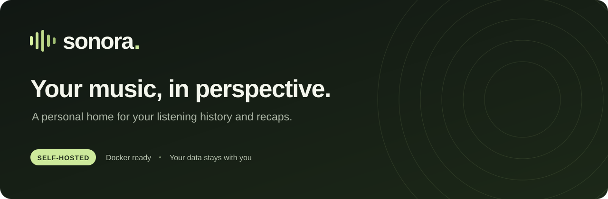
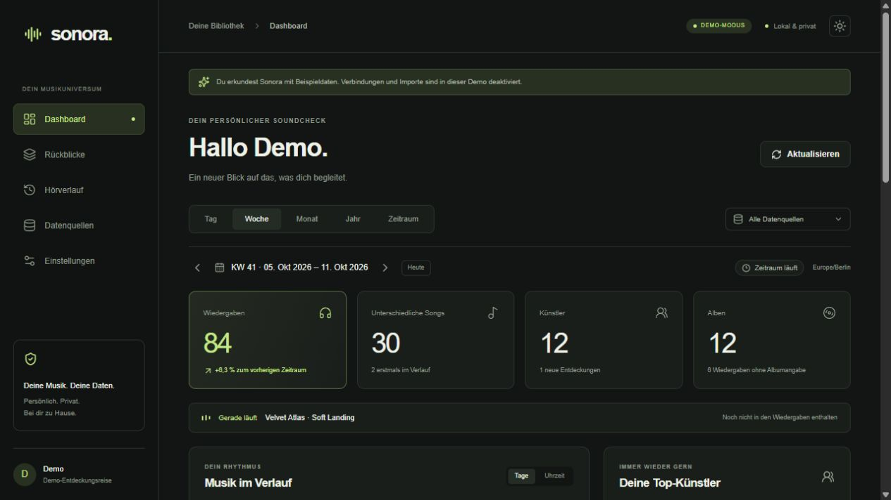
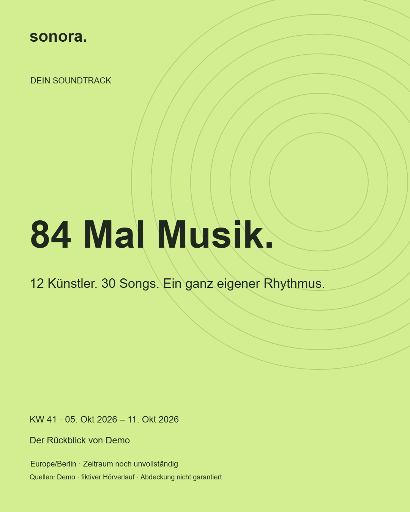

<p align="center">
  
</p>

<p align="center">
  <a href="https://github.com/Lua-x/Sonora/actions/workflows/ci.yml"></a>
  <a href="https://github.com/Lua-x/Sonora/releases"></a>
  <a href="https://github.com/Lua-x/Sonora/pkgs/container/sonora"></a>
</p>

<p align="center">
  <a href="#quick-start">Quick start</a> ·
  <a href="#a-look-inside">Screenshots</a> ·
  <a href="#bring-your-listening-history">Data sources</a> ·
  <a href="docs/deployment.md">Deployment</a> ·
  <a href="https://github.com/Lua-x/Sonora/releases/latest">Release notes</a> ·
  <a href="README.de.md">Deutsch</a>
</p>

Sonora turns your listening history into a personal music dashboard and daily, weekly, monthly and yearly recaps. Run it on your own computer, server or NAS with Docker Compose. No paid cloud service or external AI is required.

**The application UI is currently in German.** This project overview and deployment guide are available in English; the German documentation is retained.

## A look inside



*An actual screenshot of the explicitly labelled demo mode. All artists, songs and listening events shown are fictional.*

| Understand your listening | Keep control of your data |
| --- | --- |
| Explore days, weeks, months, years or a custom range | Host the app, database and worker yourself |
| Discover your top songs, artists, albums and listening patterns | Import CSV, JSON and personal Spotify export files |
| Compare periods and find first appearances in your history | Keep source attribution and coverage limitations visible |
| Save personal recap cards as PNG images | Export your history, disconnect sources or delete your data |
| Switch between dark and light themes on desktop or mobile | Use a protected personal account with no default password |

<details>
<summary><strong>Preview an exported recap card</strong></summary>
<br />
<p align="center"></p>

Cards use original graphics and text, without third-party album artwork. The export includes the period, time zone, sources and coverage caveats.
</details>

## Quick start

You need **Docker Engine or Docker Desktop with Linux containers**, **Docker Compose v2**, and Git. The published container supports **Linux/amd64**. Local source builds depend on the architectures supported by the pinned base images and dependencies; other architectures have not been verified.

### 1. Get Sonora

```sh
git clone https://github.com/Lua-x/Sonora.git
cd Sonora
git checkout v0.1.0
```

### 2. Generate your private configuration

With Node.js 24 installed:

```sh
node scripts/setup-env.mjs
```

Or use Docker, without installing Node locally (Bash or PowerShell):

```sh
docker run --rm -v "${PWD}:/app" -w /app public.ecr.aws/docker/library/node:24.21.0-bookworm-slim node scripts/setup-env.mjs
```

This creates `.env` with a random database password, encryption key and one-time setup token. It never overwrites an existing `.env`. Keep this file private and back up the encryption key.

### 3. Start the containers

```sh
docker compose up -d --build
docker compose ps
```

Compose starts **PostgreSQL → migrations → web app + background worker**. Data lives in a persistent Docker volume. The migration container exiting successfully is expected.

Open **[localhost:3000](http://localhost:3000)** on the computer running Docker. Enter the `SETUP_TOKEN` from your `.env`, choose a display name and set your own password of at least 12 characters.

> **Installing on a server or NAS?** `localhost` refers to that machine. The default port is bound to its loopback interface. For access from other devices, use the [HTTPS reverse-proxy setup](docs/deployment.md#access-from-other-devices) and set `APP_URL` to your actual address.

### Prefer the published image?

Set this value in `.env`:

```dotenv
SONORA_IMAGE=ghcr.io/lua-x/sonora:0.1.0
```

Then start without a local build:

```sh
docker compose pull web worker migrate
docker compose up -d --no-build
```

If the package is private, authenticate to GHCR first with an account that has `read:packages` access. See [deployment](docs/deployment.md#published-images-and-updates). Images are also tagged `main` and `sha-<full-commit>`; use a release tag or digest for a controlled deployment.

## Try the demo

```sh
docker compose -f compose.demo.yaml up -d --build
```

Open [localhost:3001](http://localhost:3001). The separate, read-only demo contains about 1,200 fictional events across 90 days. It needs no music accounts, secrets or database, and does not load personal data.

```sh
docker compose -f compose.demo.yaml down
```

## Bring your listening history

| Source | What Sonora supports | What you need |
| --- | --- | --- |
| **Last.fm** | Existing scrobbles and regular background synchronization | A Last.fm username and your own API key; a scrobbler must already send your listening activity to Last.fm |
| **ListenBrainz** | Public listens, regular synchronization and official history-export imports | A public username; import the official export for older history and explicitly select the matching account as its target |
| **CSV / JSON** | Validated preview, background import and repeat-import deduplication | Your own history file, up to 20 MiB / 100,000 rows per file |
| **Personal Spotify export** | Regular and extended listening-history JSON files | Your own downloaded data export; no direct Spotify API integration |

Connecting Last.fm or ListenBrainz does not automatically capture every streaming service. Coverage depends on the scrobbler or recording method you have configured. Sonora cannot reconstruct events missing from the original provider.

The [integration review](docs/integrations.md) documents official APIs, provider limits, attribution and the separate scope of personal Spotify file imports. Podcasts and audiobooks are skipped. Direct Spotify, Apple Music and YouTube Music connectors are not enabled.

<details>
<summary><strong>CSV / JSON format and duplicate handling</strong></summary>

```csv
externalId,playedAt,artist,track,album,durationMs,durationKind,tags
my-event-001,2026-10-08T18:30:00Z,Example Artist,Example Song,Example Album,183000,measured,Indie|Electronic
```

JSON accepts an array or an object containing an `events` array. Required fields: `playedAt` with a UTC offset, `artist` and `track`. Optional fields: `externalId`, `album`, `durationMs`, `durationKind` (`measured` or `estimated`) and `tags`. JSON tags are an array; CSV tags use `|` separators. A duration without an explicit kind is treated as an estimate.

Stable IDs are checked within each source. Identical repeat imports do not create duplicates; conflicting IDs with different timestamps, artists or titles are reported. Legitimate repeat plays remain separate. Without provider IDs, identical events split across different files are not always distinguishable: import complete original files together and review the preview warnings.

Similar events from different sources remain separate and are flagged as possible overlaps. Import previews expire after 24 hours. Invalid files must be corrected before they can be imported.
</details>

## Numbers with context

- **Calendar-aware:** UTC storage with your chosen IANA time zone; Monday-based weeks, daylight saving, leap years and inclusive custom end dates.
- **Honest listening time:** measured playback duration and estimated song lengths are shown separately. Missing duration stays unknown.
- **Comparable periods:** an unfinished period is compared with the same local calendar progress in the preceding period.
- **New to your history:** first appearances are checked against all available stored history, even when filtering by source.
- **Separate live playback:** “now playing” is not counted as a completed listen.
- **Visible uncertainty:** source errors, known gaps and possible overlaps remain visible. First and last records do not prove continuous coverage.

Dashboard, recaps and exports share the same analytics. Recaps are recalculated on request, so later imports are reflected automatically. Tags are displayed only when present in the source data.

## Built for self-hosting

```text
Browser ── HTTPS reverse proxy ── Web app
                                   │
                              PostgreSQL
                                   │
                            Background worker
                                   │
                         Last.fm / ListenBrainz
```

**TypeScript · Next.js / React · PostgreSQL / Drizzle · Recharts · Luxon**

A separate Node worker processes a persistent PostgreSQL queue for imports and synchronization. No Redis is required. Custom CSS and semantic React components keep the UI dependency surface small. PGlite is used only for development and tests; Docker runs PostgreSQL.

The personal account uses a one-time setup token, hashed sessions, same-origin checks and server-side encrypted source secrets. Settings support personal history export and deletion. Disconnecting a source removes its credentials and stops new syncs while preserving history unless you explicitly delete it.

## Development and verification

Use Node.js 24:

```sh
npm ci
npm run check
npm run build
```

With PostgreSQL configured, run `npm run db:migrate`, `npm run dev` and `npm run worker` in the appropriate processes. Next.js loads `.env` for the web app; standalone scripts need their environment explicitly, for example `node --env-file=.env --import tsx scripts/migrate.ts`. See the [German development notes](README.de.md#architektur-und-entwicklung) for isolated PGlite development.

**80 tests** cover analytics, time boundaries, imports, security, database behavior and controlled connector responses. CI additionally builds the production image and starts PostgreSQL, migrations, web and worker. It checks setup, protected access, imports, deduplication, all four recap periods, export and data persistence after container recreation before publishing to GHCR.

The UI has been checked in a browser, including setup, import, history, responsive navigation and a real PNG download. **Live synchronization against the owner's Last.fm or ListenBrainz account has not been verified**; accounts will be configured later. Mocked provider responses do not prove a particular account's coverage.

## Documentation

| Guide | Language |
| --- | --- |
| [Deployment, HTTPS, updates and backups](docs/deployment.md) | English |
| [Release notes](docs/releases/v0.1.0.md) | English |
| [Full German overview](README.de.md) | Deutsch |
| [Detailed operations handbook](docs/operations.md) | Deutsch |
| [Provider API and usage review](docs/integrations.md) | Deutsch |
| [Implementation and acceptance record](docs/progress.md) | Deutsch |

Found a reproducible problem? [Open an issue](https://github.com/Lua-x/Sonora/issues) with the version and steps to reproduce. Keep `.env`, API keys and personal listening history out of reports.
